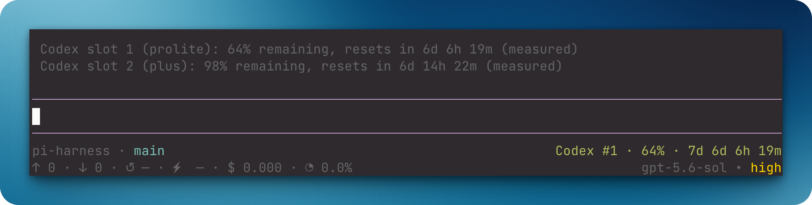
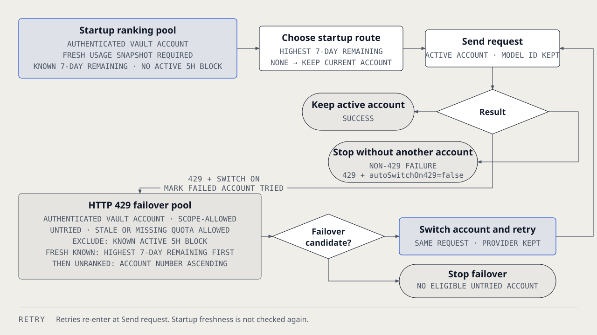

# `@ayagikei/pi-multi-codex`

Add multiple ChatGPT Codex OAuth accounts and start Pi work on the eligible account with the most weekly quota. The extension switches away from active five-hour blocks and can retry an HTTP 429 on another eligible account. Pi keeps the `openai-codex` model and provider; only the active vault account changes.




## Install

```bash
pi install git:github.com/Ayagikei/pi-multi-codex@v2.0.0
```

## Works with

| Package | Relationship | Purpose |
| --- | --- | --- |
| [`@henryqw/pi-footer`](https://pi.henry.wang/extensions/pi-footer) | Improves | Shows the active account's quota or five-hour block in the footer. |
| [`@henryqw/pi-subagent`](https://pi.henry.wang/extensions/pi-subagent) | Improves | Child sessions use the same global active Codex account. |
| [`@henryqw/pi-task-models`](https://pi.henry.wang/extensions/pi-task-models) | Improves | Account switches keep the `openai-codex` profile route. |

## Use

Run `/login` and authenticate `OpenAI Codex` first. Run `/codex-add`, then run `/login` and select `OpenAI Codex` again. Run `/codex-status`.

`/codex-status` lists vault accounts. It shows cached quota when available, or `unavailable` until the first successful snapshot.

The footer and `/codex-status` show the five-hour reset countdown for Free, Go, and Plus tiers. They show the seven-day reset countdown for Pro Lite and other tiers.

| Surface | Type | Purpose |
| --- | --- | --- |
| `/codex-add` | command | Create a pending vault account, then authenticate it with `/login`. |
| `/codex-status` | command | Show shared quota snapshots and five-hour blocks. Never waits on network. |
| `/codex-switch` | command | Pick an authenticated vault account. |

A numbered account is one Codex identity in the package vault.

## Flow

The flowchart above shows the default behavior with both automatic switches enabled.

- With `autoSelectOnStartup` enabled, before the first agent start, only fresh quota snapshots enter startup ranking. The account with the most seven-day quota wins.
- An explicit `/codex-switch` account selection always wins for the next agent start; selecting a Codex model does not pin an account.
- With `autoSelectOnStartup` enabled, before later agent starts, a known active five-hour block switches to the eligible fresh account with the most seven-day quota.
- After HTTP 429, failover can use authenticated, scope-allowed, untried accounts with stale or missing quota.
- Failover skips known active five-hour blocks. It ranks fresh known quota first, then unranked accounts by account number.
- Routing keeps the model ID and the `openai-codex` provider. It changes `accounts.json` `activeAccountId` only.
- During one agent run, each eligible account is tried at most once after HTTP 429 responses.
- Automatic retry stops when no untried eligible account remains.
- The footer shows the active account's fresh quota or five-hour block.

## Config

Package-owned: `~/.pi/agent/config/pi-multi-codex/config.json`

| Name | Description | Values | Default |
| --- | --- | --- | --- |
| `autoSelectOnStartup` | Selects the account with the most weekly quota before the first agent start, and switches away from known five-hour blocks before later starts. | Boolean. | `true` |
| `autoSwitchOn429` | Switches to another eligible account after an HTTP 429. | Boolean. | `true` |

To keep the current account instead of automatically selecting by weekly quota:

```json
{
  "autoSelectOnStartup": false,
  "autoSwitchOn429": true
}
```

`/codex-switch`, quota refreshes, and quota displays still work. HTTP 429 failover is controlled separately by `autoSwitchOn429`; set both fields to `false` to disable all automatic account switching.

Existing configs containing only `autoSwitchOn429` remain valid and default `autoSelectOnStartup` to `true`. The config must contain `autoSwitchOn429` and may contain `autoSelectOnStartup`, both as booleans; no other fields are allowed. Invalid config is preserved and disables both automatic switches.

Run `/reload` or restart Pi after changing the config. Account selection is shared across sessions: other sessions with automatic switching enabled can still change the global active account.

## State and storage

The extension stores Codex OAuth credentials in `~/.pi/agent/config/pi-multi-codex/accounts.json`. Startup copies existing `openai-codex` and `openai-codex-N` logins into this vault. After `/login` or a token refresh, Pi's `auth.json` `openai-codex` entry becomes a non-secret marker.

The extension also maintains a generated, credential-free quota cache at `~/.pi/agent/config/pi-multi-codex/usage.json`.

## Limits and recovery

The extension does not delete leftover `openai-codex-N` entries from `auth.json`; Pi ignores those aliases because the extension no longer registers them.

Invalid `accounts.json` is left unchanged. Commands warn and skip vault writes until you fix or replace the file.

`/codex-switch` works regardless of the current model. The selected credential is used by subsequent `openai-codex` requests.

## Origin

Standalone fork of [`@henryqw/pi-multi-codex`](https://github.com/HenryQW/pi-harness/tree/main/extensions/pi-multi-codex). The original MIT license and copyright notice are preserved.
